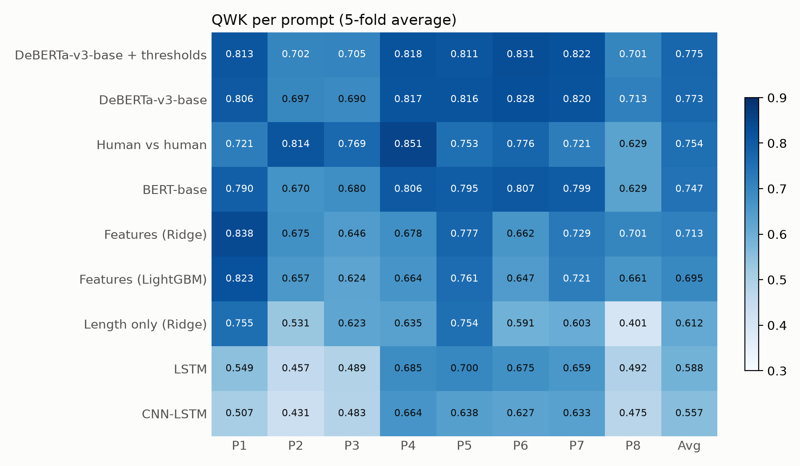
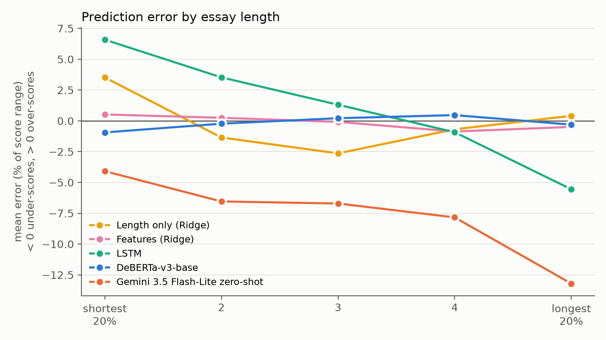
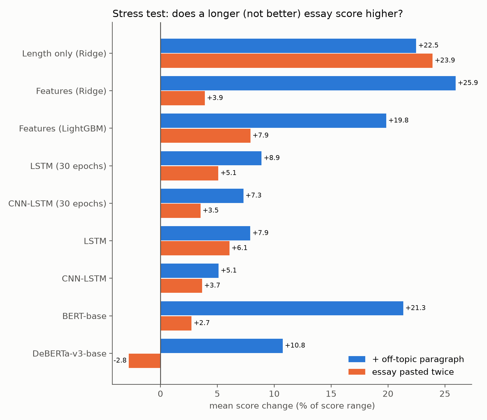

# Automated Essay Scoring: From LSTMs to LLM Graders

Dilip Suthar · Lakhan Rathore · Manish Chhaba · Ashwin Yadav

Deep Learning course project · <a href="https://github.com/Dilip0552/essay-grader-lstm-to-llm">github.com/Dilip0552/essay-grader-lstm-to-llm</a>

Abstract. We compare four families of automated essay scorers on the ASAP dataset, all evaluated on the standard 5-fold splits of Taghipour &amp; Ng (2016): hand-made features, an LSTM, fine-tuned BERT and DeBERTa-v3, and a rubric-prompted LLM. DeBERTa-v3-base reaches a quadratic weighted kappa of 0.775, compared with 0.754 between two human raters. Word count alone already reaches 0.612. A stress test shows that appending an off-topic paragraph raises scores by +25.9% of the score range for a feature model, +21.3% for BERT and +10.8% for DeBERTa. Agreement with teachers therefore does not imply robustness to gaming. We recommend AI-suggested, teacher-confirmed grading with automatic flags for review.

Every number in this report is generated by <code>scripts/build_report.py</code> from the files in <code>reports/results/</code>.

## 1. Task

Automated essay scoring (AES) predicts the score a teacher would give a student essay. We compare four kinds of model, from simple to advanced:

1. hand-made features,
2. the LSTM of Taghipour & Ng (2016),
3. a fine-tuned transformer (DeBERTa-v3, with BERT for comparison),
4. a large language model (LLM) prompted with the official rubric.

We measure how well each one agrees with human teachers. We also ask two practical questions: do these models reward length instead of quality, and could a teacher use one safely?

## 2. Data and evaluation protocol

- **Dataset:** ASAP-AES (Hewlett Foundation, Kaggle 2012). It has 12,976 essays written by US students in grades 7–10 for 8 prompts. Each prompt has its own score range, from 0–3 up to 0–60.
- **Splits:** the 5-fold splits published with Taghipour & Ng's code (nusnlp/nea), each with train/dev/test sets of about 60/20/20%. Using them keeps our numbers comparable with the paper and with later work. Two IDs in those splits (10535 and 10536) are no longer in the Kaggle file, so we skip them.
- **Metric:** Quadratic Weighted Kappa (QWK), computed per prompt and per fold, averaged over folds, then over prompts.
  - QWK is 1 for perfect agreement and 0 for chance.
  - Large disagreements are penalized much more than near-misses.
- **Ceiling:** agreement between the two human raters (rater 1 vs rater 2). For prompts 1, 7 and 8 the final score is about the sum of the two raters, so the human agreement there is measured on each rater's smaller scale.
- **Prompt-aware scaling:** every model predicts scores scaled to [0, 1] within the essay's prompt range. Predictions are mapped back to that range and rounded before computing QWK.

## 3. Models

| Model | Input | Training | Notes |
|---|---|---|---|
| Length only | word count | Ridge, one per prompt | How far length alone goes |
| Features | 12 features: length, vocabulary, sentence length, readability, punctuation | Ridge or LightGBM, one per prompt | Classic baseline |
| LSTM / CNN-LSTM | word embeddings (vocabulary 4,000) | one per prompt; RMSprop, MSE loss; best epoch chosen by dev QWK | Taghipour & Ng: 300-unit LSTM, mean-over-time pooling, sigmoid output |
| BERT-base / DeBERTa-v3-base | subword tokens; first 128 + last 382 tokens of long essays | one model for all prompts, text prefixed with its prompt number; AdamW 2e-5, 3 epochs, fp16 | Best epoch chosen by dev QWK |
| DeBERTa + thresholds | same | rounding cut-points tuned per prompt on dev | |
| Gemini 3.5 Flash-Lite | official rubric and task text, plus 0 or 3 scored example essays | none (prompted) | Answers in JSON. Invalid answers are retried once, then replaced by the prompt's median score. |

**Differences from the original paper:**

- LSTM embeddings start random; the paper used pretrained ones.
- Training length matches the paper (50 epochs). An extra 30-epoch run on 2 folds is reported only as a comparison.
- The transformers are trained with a single seed.
- The LLM grades a fixed subset of 200 fold-0 test essays (25 per prompt), because of free-tier limits.

## 4. Results

<b>Table 1. </b>QWK per prompt, averaged over the 5 folds (higher is better).

|                              |    P1 |    P2 |    P3 |    P4 |    P5 |    P6 |    P7 |    P8 |   Avg |
|:-----------------------------|------:|------:|------:|------:|------:|------:|------:|------:|------:|
| DeBERTa-v3-base + thresholds | 0.813 | 0.702 | 0.705 | 0.818 | 0.811 | 0.831 | 0.822 | 0.701 | 0.775 |
| DeBERTa-v3-base              | 0.806 | 0.697 | 0.690 | 0.817 | 0.816 | 0.828 | 0.820 | 0.713 | 0.773 |
| Human vs human               | 0.721 | 0.814 | 0.769 | 0.851 | 0.753 | 0.776 | 0.721 | 0.629 | 0.754 |
| BERT-base                    | 0.790 | 0.670 | 0.680 | 0.806 | 0.795 | 0.807 | 0.799 | 0.629 | 0.747 |
| Features (Ridge)             | 0.838 | 0.675 | 0.646 | 0.678 | 0.777 | 0.662 | 0.729 | 0.701 | 0.713 |
| Features (LightGBM)          | 0.823 | 0.657 | 0.624 | 0.664 | 0.761 | 0.647 | 0.721 | 0.661 | 0.695 |
| Length only (Ridge)          | 0.755 | 0.531 | 0.623 | 0.635 | 0.754 | 0.591 | 0.603 | 0.401 | 0.612 |
| LSTM                         | 0.549 | 0.457 | 0.489 | 0.685 | 0.700 | 0.675 | 0.659 | 0.492 | 0.588 |
| CNN-LSTM                     | 0.507 | 0.431 | 0.483 | 0.664 | 0.638 | 0.627 | 0.633 | 0.475 | 0.557 |

<b>Table 2. </b>QWK on the 200-essay subset (fold-0 test, 25 per prompt) graded by every model, including the LLM. Per-prompt values rest on 25 essays each, so they are noisy.

|                                 |    P1 |    P2 |    P3 |    P4 |    P5 |    P6 |    P7 |    P8 |   Avg |
|:--------------------------------|------:|------:|------:|------:|------:|------:|------:|------:|------:|
| Length only (Ridge)             | 0.776 | 0.575 | 0.591 | 0.644 | 0.754 | 0.581 | 0.266 | 0.282 | 0.559 |
| Features (Ridge)                | 0.875 | 0.792 | 0.699 | 0.637 | 0.726 | 0.689 | 0.502 | 0.746 | 0.708 |
| Features (LightGBM)             | 0.842 | 0.767 | 0.716 | 0.671 | 0.769 | 0.765 | 0.450 | 0.661 | 0.705 |
| LSTM (30 epochs)                | 0.390 | 0.639 | 0.431 | 0.704 | 0.650 | 0.724 | 0.760 | 0.663 | 0.620 |
| CNN-LSTM (30 epochs)            | 0.481 | 0.545 | 0.500 | 0.623 | 0.506 | 0.596 | 0.707 | 0.646 | 0.576 |
| LSTM                            | 0.548 | 0.639 | 0.312 | 0.663 | 0.455 | 0.724 | 0.760 | 0.663 | 0.595 |
| CNN-LSTM                        | 0.422 | 0.539 | 0.514 | 0.778 | 0.597 | 0.589 | 0.706 | 0.630 | 0.597 |
| BERT-base                       | 0.796 | 0.815 | 0.654 | 0.933 | 0.661 | 0.724 | 0.737 | 0.586 | 0.738 |
| DeBERTa-v3-base                 | 0.831 | 0.848 | 0.693 | 0.849 | 0.826 | 0.720 | 0.734 | 0.629 | 0.766 |
| DeBERTa-v3-base + thresholds    | 0.882 | 0.816 | 0.751 | 0.835 | 0.704 | 0.763 | 0.778 | 0.674 | 0.775 |
| Gemini 3.5 Flash-Lite zero-shot | 0.368 | 0.662 | 0.659 | 0.741 | 0.477 | 0.626 | 0.587 | 0.396 | 0.564 |
| Gemini 3.5 Flash-Lite few-shot  | 0.427 | 0.826 | 0.633 | 0.870 | 0.509 | 0.658 | 0.473 | 0.431 | 0.603 |

<figure><figcaption><b>Figure 1.</b> QWK per prompt for every model evaluated on all 5 folds, with the human–human row for reference. Darker cells mean higher agreement.</figcaption></figure>

**DeBERTa-v3-base is the best model.** It reaches an average QWK of 0.773, and 0.775 with tuned rounding thresholds. That is above the human–human agreement of 0.754, and higher than the human row on 5 of the 8 prompts.

This comparison is not exactly like-for-like. Models are scored against the *resolved* score, which for prompts 1, 7 and 8 combines both raters. The human row compares one rater with the other. The fair reading is that DeBERTa agrees with the official score about as well as two trained teachers agree with each other. It is weakest on prompts 2, 3 and 8, where humans also disagree most or the essays are longest.

Tuning the rounding thresholds per prompt adds only a little (0.773 → 0.775). The fine-tuned model is already well calibrated.

**The newer encoder matters.** BERT-base, trained with exactly the same recipe, reaches 0.747 against DeBERTa's 0.773. It falls furthest behind on prompt 8, the longest essays (0.629 vs 0.713). BERT trains about twice as fast (56 vs 112 GPU-minutes for 5 folds). With off-topic padding, BERT's scores move +21.3%, against +10.8% for DeBERTa.

**Simple features remain a strong baseline.** Ridge regression on 12 features reaches 0.713, in line with the EASE feature system reported by Taghipour & Ng (2016). Word count *alone* gives 0.612, and on prompt 1 it scores 0.755, above the human raters' 0.721.

**Our LSTM falls short of the paper.** We get 0.588 (CNN-LSTM: 0.557), against about 0.75 reported in the paper.

- **Epochs are not the cause.** On the 2 folds where both versions finished, QWK was 0.589 after 30 epochs and 0.593 after 50.
- **The likely cause is pretrained embeddings.** The paper initialised from pretrained word embeddings; ours start random and learn from only about 1,000 essays per prompt.
- **Remaining differences:** smaller ones in tokenisation and preprocessing.

We report this gap honestly rather than tuning towards the published number.

**The LLM grader is the weakest learned approach.** We graded the 200-essay subset with Gemini 3.5 Flash-Lite, prompted with the official rubric:

- **Zero-shot:** QWK 0.564. It is too harsh on average (mean error -7.7% of the score range).
- **Few-shot**, with three scored examples per prompt: 0.603 (mean error -5.2%).
- **DeBERTa on the same essays:** 0.766.

The LLM struggles most on prompts 1 and 8, which have the longest essays and the widest score scales. It returned no invalid answers.

## 5. Do models over-reward length?

We use two tests.

1. **Error vs length (observational).** We correlate each essay's prediction error with its length, within each prompt.
2. **Stress test (interventional).** We make each test essay longer without making it better, then re-score it:
   - *off-topic*: append a neutral ~110-word paragraph about weather and a bakery;
   - *repeat*: paste the essay twice.

   A fair grader should not raise these scores.

<b>Table 3. </b>Correlation with essay length (in words), averaged over prompts. Errors that grow with length show as a non-zero first column.

| Model                           |   corr(error, length) |   corr(prediction, length) |   corr(human score, length) |
|:--------------------------------|----------------------:|---------------------------:|----------------------------:|
| Length only (Ridge)             |                -0.020 |                      0.931 |                       0.693 |
| Features (Ridge)                |                -0.006 |                      0.838 |                       0.693 |
| Features (LightGBM)             |                 0.003 |                      0.795 |                       0.693 |
| LSTM (30 epochs)                |                -0.293 |                      0.501 |                       0.688 |
| CNN-LSTM (30 epochs)            |                -0.325 |                      0.475 |                       0.688 |
| LSTM                            |                -0.275 |                      0.504 |                       0.693 |
| CNN-LSTM                        |                -0.319 |                      0.469 |                       0.693 |
| BERT-base                       |                -0.033 |                      0.730 |                       0.693 |
| DeBERTa-v3-base                 |                -0.011 |                      0.742 |                       0.693 |
| DeBERTa-v3-base + thresholds    |                 0.113 |                      0.740 |                       0.693 |
| Gemini 3.5 Flash-Lite zero-shot |                -0.169 |                      0.538 |                       0.622 |
| Gemini 3.5 Flash-Lite few-shot  |                -0.016 |                      0.603 |                       0.622 |

<b>Table 4. </b>Stress test on all test essays: score change after making the essay longer but not better.

| Model                | Variant   |   Mean score change (% of range) |   % essays scored higher |   % essays scored lower |
|:---------------------|:----------|---------------------------------:|-------------------------:|------------------------:|
| Length only (Ridge)  | offtopic  |                           22.470 |                   85.600 |                   0.000 |
| Length only (Ridge)  | repeat    |                           23.920 |                   86.800 |                   0.000 |
| Features (Ridge)     | offtopic  |                           25.940 |                   86.800 |                   0.000 |
| Features (Ridge)     | repeat    |                            3.900 |                   32.900 |                  23.600 |
| Features (LightGBM)  | offtopic  |                           19.840 |                   74.200 |                   1.300 |
| Features (LightGBM)  | repeat    |                            7.910 |                   42.900 |                  10.000 |
| LSTM (30 epochs)     | offtopic  |                            8.890 |                   47.800 |                  11.200 |
| LSTM (30 epochs)     | repeat    |                            5.090 |                   20.300 |                   0.700 |
| CNN-LSTM (30 epochs) | offtopic  |                            7.290 |                   42.500 |                  14.500 |
| CNN-LSTM (30 epochs) | repeat    |                            3.520 |                   14.000 |                   0.300 |
| LSTM                 | offtopic  |                            7.900 |                   44.600 |                  14.000 |
| LSTM                 | repeat    |                            6.060 |                   23.900 |                   0.700 |
| CNN-LSTM             | offtopic  |                            5.110 |                   39.600 |                  17.700 |
| CNN-LSTM             | repeat    |                            3.660 |                   14.900 |                   0.300 |
| BERT-base            | offtopic  |                           21.340 |                   82.000 |                   0.200 |
| BERT-base            | repeat    |                            2.740 |                   27.200 |                  11.000 |
| DeBERTa-v3-base      | offtopic  |                           10.750 |                   54.900 |                   1.400 |
| DeBERTa-v3-base      | repeat    |                           -2.780 |                   15.100 |                  20.700 |

<figure><figcaption><b>Figure 2.</b> Mean signed error by essay-length quintile, computed within each prompt. A flat line at zero means no length bias. Gemini is shown on its 200-essay subset.</figcaption></figure>
<figure><figcaption><b>Figure 3.</b> Average score change when every test essay is made longer but not better, as a percentage of each prompt's score range.</figcaption></figure>

**Without any intervention, errors do not grow with length for the better models.** In this data, longer essays really do receive higher human scores (correlation 0.69). So a model that uses length is not wrong *on average*. The feature models and DeBERTa show errors essentially uncorrelated with length (-0.01 and -0.01).

The LSTM shows a clear negative correlation (-0.28). It over-scores short essays and under-scores long ones, which is regression toward the mean, not a reward for length. Zero-shot Gemini behaves similarly (-0.17), and few-shot examples remove most of this (-0.02).

**The stress test tells a different story.** It shows which models can be *gamed*:

- **Feature models:** appending an irrelevant paragraph raises scores by +25.9% of the score range (Ridge), and 87% of essays score higher. Length-only Ridge rises +22.5%.
- **DeBERTa:** more robust, but not immune. Off-topic padding raises its scores by +10.8%, with 55% of essays going up.
- **DeBERTa, essay pasted twice:** the score barely changes (-2.8%). This is partly by construction: head+tail truncation shows the model almost the same text.
- **LSTM:** moves +7.9% with off-topic padding.

**Takeaway:** average agreement (QWK) hides how easily a grader can be gamed. A model can match teachers on normal essays and still reward a student for padding. We could not run the stress test for the LLM within the free-tier quota.

## 6. Classroom feasibility

<b>Table 5. </b>Cost and speed. Times are per essay at prediction time; training time is the total over 5 folds. All runs used free resources.

| model                           | device                             | train_minutes_total   | sec_per_essay   | input_tokens_per_essay   | output_tokens_per_essay   | invalid_answers   | essays   |
|:--------------------------------|:-----------------------------------|:----------------------|:----------------|:-------------------------|:--------------------------|:------------------|:---------|
| Length only (Ridge)             | –                                  | –                     | –               | –                        | –                         | –                 | –        |
| Features (Ridge)                | –                                  | –                     | –               | –                        | –                         | –                 | –        |
| Features (LightGBM)             | –                                  | –                     | –               | –                        | –                         | –                 | –        |
| LSTM (30 epochs)                | NVIDIA GeForce RTX 3050 Laptop GPU | 42.2                  | 0.001           | –                        | –                         | –                 | –        |
| CNN-LSTM (30 epochs)            | NVIDIA GeForce RTX 3050 Laptop GPU | 43.7                  | 0.0011          | –                        | –                         | –                 | –        |
| LSTM                            | NVIDIA GeForce RTX 3050 Laptop GPU | 172.8                 | 0.001           | –                        | –                         | –                 | –        |
| CNN-LSTM                        | NVIDIA GeForce RTX 3050 Laptop GPU | 176.1                 | 0.001           | –                        | –                         | –                 | –        |
| BERT-base                       | Tesla T4                           | 55.5                  | 0.0043          | –                        | –                         | –                 | –        |
| DeBERTa-v3-base                 | Tesla T4                           | 111.5                 | 0.0091          | –                        | –                         | –                 | –        |
| DeBERTa-v3-base + thresholds    | –                                  | –                     | –               | –                        | –                         | –                 | –        |
| Gemini 3.5 Flash-Lite zero-shot | Gemini API (free tier)             | 0.0                   | 0.9             | 2602.0                   | 46.0                      | 0.0               | 200.0    |
| Gemini 3.5 Flash-Lite few-shot  | Gemini API (free tier)             | 0.0                   | 0.95            | 3744.0                   | 45.0                      | 0.0               | 200.0    |

- **Accuracy:** DeBERTa is clearly best (0.773), followed by simple features (0.713), the LSTM (0.588), and the rubric-prompted LLM (0.603 few-shot, on the subset).
- **Cost and speed:**
  - **Feature models:** train in seconds on a laptop CPU.
  - **DeBERTa:** needed about 112 GPU-minutes to train all 5 folds on a free Kaggle T4. After that it grades an essay in about 0.0091 s.
  - **LLM:** needs no training data or GPU and answers in about 0.95 s per essay. But the free tier is tightly rate-limited: one model allowed only 20 requests per day. A paid tier would cost money per essay, and the essays leave the school.
- **Explainability:**
  - **Feature models** are transparent, but easy to game.
  - **The LLM** can justify each score against the rubric in a sentence. That is useful feedback for students, but the justification is not guaranteed to reflect how the score was produced.
  - **DeBERTa** is a black box.
- **Data needs:** DeBERTa and the LSTM need hundreds of teacher-scored essays *for the same prompt*. The LLM needs only the rubric, which matters for a teacher writing a new assignment.

## 7. Recommendation for teachers

No model here should grade on its own. A safe classroom workflow:

1. **The AI suggests, the teacher decides.** Show the predicted score, plus a rubric-based explanation where available, as a starting point. The teacher confirms or changes every score that counts toward a grade.
2. **Use a fine-tuned model when teacher-scored essays exist.** If a school has a few hundred scored essays for a recurring prompt, a DeBERTa-style model agrees with the official score about as well as two teachers agree with each other. For new prompts, a rubric-prompted LLM can give first-pass feedback, but its scores are noticeably less reliable.
3. **Flag essays for closer human review** when:
   - the model's raw prediction falls between two score points;
   - two different models (for example DeBERTa and the LLM) disagree by more than one point;
   - the essay is unusually long or short for the prompt;
   - the essay contains text that looks off-topic.

   Our stress test shows padding is exactly where models fail.

4. **Audit regularly.** Have a second teacher re-score a random sample. Check agreement per prompt and per group of students, not just on average.
5. **Be open with students** that a model assisted, and that length or padding does not earn marks.

## 8. Limitations and ethics

- **Data:** ASAP is US grades 7–10, in English, from 2012, and its essays are anonymized. Results may not transfer to other classrooms.
- **Data sharing:** under the competition rules, essays must not be redistributed. The repository contains no essay text, only IDs, scores and predictions.
- **The LLM experiment:** we sent the 200 subset essays to Google's Gemini API on the free tier. Google's terms allow free-tier inputs to be used to improve its products. A real deployment should use a paid tier with no data retention, or a locally hosted model.
- **Sample size:** the LLM results come from 200 essays, so per-prompt QWK there is noisy (25 essays per prompt).
- **QWK is not everything:** a model can agree with teachers on average and still be unfair to specific groups of students, or easy to game. Section 5 shows one way it can be gamed.

## 9. Reproducing

See the README. Each experiment is one command that writes `reports/results/<name>/preds_fold*.csv`. Then run `python scripts/make_tables.py && python scripts/analyze.py && python scripts/build_report.py`.

## References

- Taghipour, K. & Ng, H. T. (2016). A Neural Approach to Automated Essay Scoring. EMNLP.
- He, P., Gao, J. & Chen, W. (2023). DeBERTaV3. ICLR.
- Sun, C. et al. (2019). How to Fine-Tune BERT for Text Classification (head+tail truncation).
- Hewlett Foundation (2012). Automated Student Assessment Prize, Kaggle.
